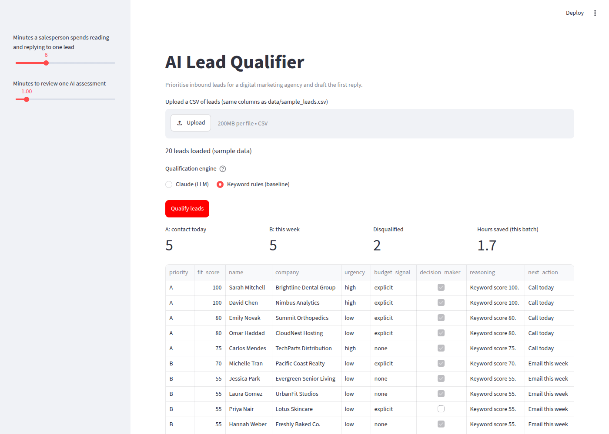

# AI Lead Qualifier

**An LLM that reads inbound leads the way a senior salesperson would: it ranks them, explains why, and drafts the first reply.**

Built from a problem I lived running a digital growth agency: every week, inbound leads arrive from forms, DMs, referrals and events. Someone has to read each one, decide who to call first and write a reply. Good leads wait while the team reads spam, students and requests for free work.

## What it does

For each lead the model returns a structured assessment:

| Field | Meaning |
|---|---|
| `priority` | A = contact today · B = this week · C = nurture · Disqualify |
| `fit_score` | 0–100 fit with the agency's ideal client |
| `budget_signal`, `urgency`, `decision_maker` | The three signals sales teams use to qualify (BANT-style) |
| `reasoning` | Why, in one or two sentences, so a human can check it |
| `next_action` | The one next step |
| `email_draft` | A personal first reply in the lead's language |



The Streamlit app lets you upload a CSV, run the qualification, see the pipeline at a glance, read the drafts and export the results.

## How it works

```
CSV of leads ─► Claude (structured output, validated by Pydantic) ─► ranked table + drafts ─► CSV export
              └► keyword baseline (offline, for comparison)
```

- **Claude** (`lead_qualifier/llm.py`) gets a short system prompt describing the agency's ideal client and the priority definitions, and must answer in a fixed schema (`lead_qualifier/schema.py`). Using a schema instead of free text means the output can go straight into a CRM.
- **Keyword baseline** (`lead_qualifier/baseline.py`) mimics the rules many small agencies use today (look for "$", "budget", "ASAP", job titles). It runs without an API key and is the benchmark the LLM has to beat.
- **Evaluation** (`evaluate.py`) compares both against a set of priorities I labelled by hand (`data/labels.csv`).

## Results

On the 20 sample leads, the keyword baseline matches the hand labels **55%** of the time. Its errors are the ones that cost an agency money: it cannot tell that a student, a freelancer looking for work or someone asking for free design is not a client, and it misses strong leads that don't use the exact keywords (e.g. "12 gyms, want to improve sign-ups in January").

Run `python evaluate.py --llm` with an API key to score Claude on the same leads.

**Business case (assumptions editable in the app):** if reading and replying to a lead takes 6 minutes and reviewing an AI assessment takes 1, an agency receiving 60 leads a week saves about **5 hours of senior sales time per week**, and the best leads get a reply the same day.

## Run it

```bash
pip install -r requirements.txt
export ANTHROPIC_API_KEY=...        # optional: without it the app uses the baseline
streamlit run app.py
python evaluate.py [--llm]
pytest
```

## Limitations and next steps

- 20 synthetic leads and one person's labels are a demo, not a validation. A real deployment would need a few hundred historical leads with known outcomes (closed / lost).
- The model should suggest, not decide: a salesperson reviews every A and every Disqualify.
- Lead data is personal data: in production, check the privacy policy and data-processing terms before sending it to any API.
- Next: connect to a CRM (HubSpot) and learn the ideal-client profile from past won deals.

---
Built by **Manuel Portugal Reis** · [LinkedIn](https://www.linkedin.com/in/manuelportugalreis/)
